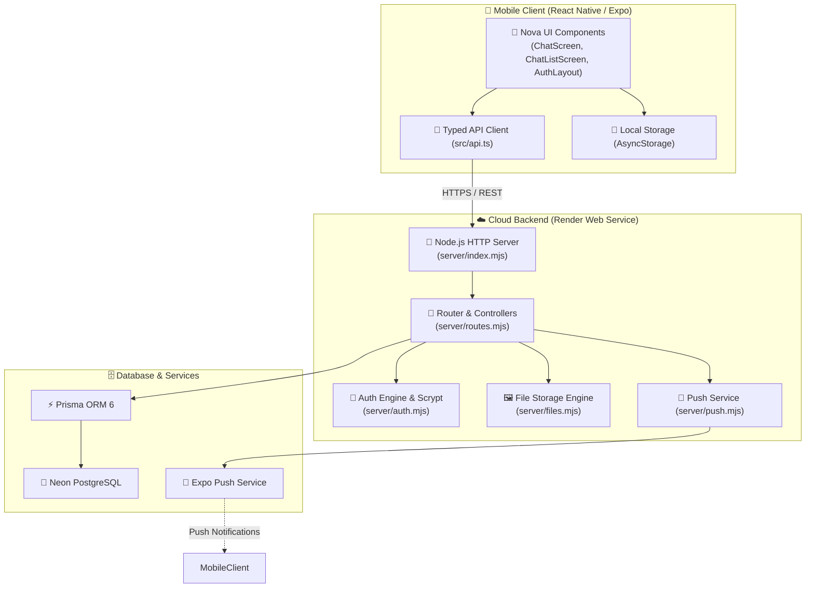

<div align="center">

# ✨ Nova Messenger

### *Next-Gen Real-Time Mobile Messaging with Electric Violet Aesthetics*

[](https://reactnative.dev/)
[](https://expo.dev/)
[](https://www.typescriptlang.org/)
[](https://www.prisma.io/)
[](https://neon.tech/)
[](https://render.com/)

[**📱 Download Android APK**](https://expo.dev/accounts/harshakarthikeya/projects/nova-chat/builds/8182e2e3-f654-4fc2-a278-0ad4381119ef) • [**🌐 Live API Health**](https://nova-chat-backend-ve3j.onrender.com/health) • [**📦 GitHub Repo**](https://github.com/HARSHAKARTHIKEYA1510/MOBILEAPP)

</div>

---

## 📖 Overview

**Nova** is a modern, high-performance mobile messaging application built with **React Native**, **Expo**, **TypeScript**, and a robust **Node.js** backend powered by **Prisma ORM** and **PostgreSQL (Neon DB)**.

Engineered from the ground up with an **Electric Violet & Radiant Indigo** design language, Nova delivers an ultra-smooth chat experience with real-time sync, cursor-based pagination, read receipts, compressed photo sharing, and Expo push notifications.

---

## 🚀 Key Features

- **🎨 Modern Design System**:
  - Electric Violet & Neon Cyan palette (`#5B4EF5`, `#7C3AED`, `#38BDF8`).
  - Dynamic squircle avatars with active online indicator rings.
  - Asymmetric curved chat bubbles (vibrant outgoing bubble, elevated white incoming bubble).
  - Floating pill-shaped composer with native keyboard avoidance across iOS & Android.

- **💬 Real-Time Messaging & Feeds**:
  - Instant conversation feeds sorted by latest activity.
  - Filter tabs: **All Chats**, **Direct Messages**, and **Groups**.
  - Read receipts with live delivery checkmarks (`✓` sent, `✓✓` delivered/read in cyan).
  - Cursor-based message pagination with infinite scroll.

- **📸 Media Attachments**:
  - In-app photo picker with automatic client-side resizing and optimization (max width 1280px).
  - Live upload preview cards with captioning support.
  - High-resolution fullscreen modal image viewer.

- **🔐 Robust Authentication & Security**:
  - Salted `scrypt` password hashing using native `node:crypto`.
  - Persistent login sessions with `AsyncStorage` and automatic profile rehydration.
  - Strict server-side participant authorization checks on all conversation routes.

- **☁️ Cloud-Native Backend**:
  - Normalized relational database schema on **Neon PostgreSQL**.
  - Hosted 24/7 on **Render** with automatic deployment on push.
  - Native Expo Push Notification integration.

---

## 🏗️ Architecture



---

## 🛠️ Tech Stack

| Layer | Technology | Description |
|---|---|---|
| **Mobile Frontend** | **React Native 0.88 & Expo SDK 58** | Cross-platform native mobile framework |
| **Language** | **TypeScript 6.0** | End-to-end type safety |
| **State & Storage** | **React Hooks & AsyncStorage** | Client-side reactive state & persistent sessions |
| **Styling** | **Custom Design System (`src/theme.ts`)** | Zero-dependency responsive style tokens |
| **Icons & Media** | **`@expo/vector-icons` & `expo-image-picker`** | Vector iconography and media library handling |
| **Backend API** | **Node.js (ESM)** | Lightweight, zero-dependency REST HTTP engine |
| **ORM** | **Prisma ORM 6.19** | Type-safe database queries and migrations |
| **Database** | **Neon PostgreSQL** | Serverless cloud PostgreSQL instance |
| **Hosting** | **Render** | Auto-deploying cloud Web Service |
| **CI/CD & Mobile Build** | **EAS (Expo Application Services)** | Cloud Android APK & bundle packaging |

---

## 📡 REST API Reference

The backend is live at: `https://nova-chat-backend-ve3j.onrender.com`

| Method | Endpoint | Auth Required | Description |
|---|---|:---:|---|
| `GET` | `/health` | No | Server health check and status |
| `POST` | `/auth/signup` | No | Register a new username and password |
| `POST` | `/auth/login` | No | Authenticate credentials and return user profile |
| `GET` | `/user/profile` | Yes | Get the authenticated user's profile |
| `GET` | `/user` | Yes | List all registered users (for contact discovery) |
| `GET` | `/conversation` | Yes | Get all conversations for the current user |
| `POST` | `/conversation` | Yes | Create a new DM or group conversation |
| `GET` | `/message` | Yes | Fetch paginated messages with `conversation_id` & cursor |
| `POST` | `/message` | Yes | Send a new message (text, photo, or attachment) |
| `POST` | `/file` | Yes | Upload base64 encoded media (up to 10 MB) |
| `GET` | `/file/:id` | Yes | Download or stream a file by ID |
| `POST` | `/push/register` | Yes | Register an Expo push notification token |
| `POST` | `/push/unregister` | Yes | Unregister an Expo push token on logout |

---

## 💻 Getting Started Locally

### Prerequisites
- **Node.js**: v20+
- **npm**: v10+
- **Expo Go** app on your physical mobile device (or Android Studio / Xcode simulator)

### 1. Clone the Repository
```bash
git clone https://github.com/HARSHAKARTHIKEYA1510/MOBILEAPP.git
cd MOBILEAPP/chat-app
```

### 2. Install Dependencies
```bash
npm install
```

### 3. Configure Environment Variables
Create a `.env` file in the `chat-app` directory:
```env
# Neon PostgreSQL Connection String
DATABASE_URL="postgresql://<user>:<password>@<endpoint>.neon.tech/<dbname>?sslmode=require"

# Local Server Configuration
PORT=3000
HOST=0.0.0.0

# Mobile API URL (Use Render for cloud, or your LAN IP for local testing)
EXPO_PUBLIC_API_URL=https://nova-chat-backend-ve3j.onrender.com
```

### 4. Push Schema to Database
```bash
npm run db:push
```

### 5. Start the Development Server
```bash
# Terminal 1 - Local Backend (optional if using live Render URL)
npm run server:dev

# Terminal 2 - Mobile Frontend (Expo)
npm start
```

Press **`a`** for Android Emulator, **`i`** for iOS Simulator, or scan the QR code using the **Expo Go** app on your phone.

---

## 📱 Building the Standalone APK with EAS

Nova is configured for standalone production builds via **EAS Build**:

1. Install EAS CLI:
   ```bash
   npm install -g eas-cli
   ```
2. Log in to your Expo account:
   ```bash
   eas login
   ```
3. Trigger an Android APK build:
   ```bash
   eas build -p android --profile preview
   ```
4. Once completed, download your `.apk` directly from the generated dashboard link.

---

## 📂 Project Structure

```text
MOBILEAPP/
├── chat-app/                       # Main React Native Application
│   ├── assets/                     # App icons, splash screens, and adaptive assets
│   ├── prisma/
│   │   └── schema.prisma           # Normalized PostgreSQL database schema
│   ├── server/                     # Standalone Node.js REST API Backend
│   │   ├── auth.mjs                # Salted scrypt hashing and authentication
│   │   ├── db.mjs                  # PrismaClient singleton with reconnect handling
│   │   ├── files.mjs               # File and photo storage handlers
│   │   ├── index.mjs               # HTTP server entry point with CORS & logging
│   │   ├── push.mjs                # Expo Push Notification service
│   │   └── routes.mjs              # REST endpoints & conversation logic
│   ├── src/
│   │   ├── api.ts                  # Typed REST API client
│   │   ├── AuthLayout.tsx          # Responsive login/signup layout & inputs
│   │   ├── Avatar.tsx              # Squircle initials avatar with status badge
│   │   ├── ChatListScreen.tsx      # Conversation list, tabs, search, and FAB
│   │   ├── ChatScreen.tsx          # Inverted thread, bubbles, composer & lightbox
│   │   ├── LoginScreen.tsx         # Sign-in screen
│   │   ├── SignupScreen.tsx        # Registration screen
│   │   ├── notifications.ts        # Push notification listener & token setup
│   │   └── theme.ts                # Electric Violet color tokens & formatters
│   ├── app.json                    # Expo configuration & plugins
│   ├── eas.json                    # EAS Build profiles (development, preview, prod)
│   ├── google-services.json        # Android FCM configuration
│   └── package.json                # Project dependencies and npm scripts
├── render.yaml                     # Infrastructure as Code blueprint for Render
└── README.md                       # Repository documentation
```

---

## 📄 License

This project is licensed under the [MIT License](chat-app/LICENSE).

---

<div align="center">
Built with ❤️ by <b>Palaparthi Harsha Karthikeya</b>
</div>
